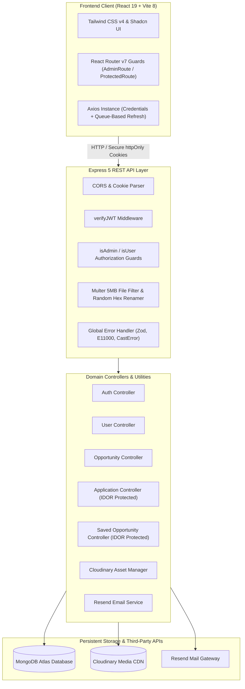

<div align="center">


# Oppora

**The Unified Opportunity Discovery & Application Tracking Platform**

[](https://oppora-iota.vercel.app)
[](frontend/README.md)
[](backend/README.md)
[](https://www.mongodb.com/)
[](https://opensource.org/licenses/ISC)

*Oppora connects aspiring students with verified scholarships, internships, hackathons, and research grants, providing an end-to-end application tracking workflow and administrative governance tools.*

[Explore Live Demo](https://oppora-iota.vercel.app) · [Frontend Documentation](frontend/README.md) · [Backend API Documentation](backend/README.md)

</div>

---

## Table of Contents

- [Problem Statement & Overview](#problem-statement--overview)
- [Key Features](#key-features)
- [User Roles & Permissions](#user-roles--permissions)
- [Application Preview & Workflow](#application-preview--workflow)
- [Technology Stack](#technology-stack)
- [System Architecture](#system-architecture)
- [Repository Structure](#repository-structure)
- [Getting Started & Local Setup](#getting-started--local-setup)
  - [Prerequisites](#prerequisites)
  - [1. Backend Setup](#1-backend-setup)
  - [2. Frontend Setup](#2-frontend-setup)
- [Environment Configuration](#environment-configuration)
- [Available Scripts](#available-scripts)
- [API Overview](#api-overview)
- [Security & Engineering Highlights](#security--engineering-highlights)
- [Known Limitations & Current Scope](#known-limitations--current-scope)
- [Future Roadmap](#future-roadmap)
- [Contributing](#contributing)
- [License](#license)

---

## Problem Statement & Overview

Students frequently miss out on career-defining opportunities—scholarships, competitive internships, hackathons, fellowships, and research grants—due to scattered listings, expired links, and disjointed tracking spreadsheets. At the same time, academic coordinators and student mentors lack centralized tools to publish verified listings and monitor student engagement.

**Oppora** solves this problem by delivering:
1. **A Single Source of Truth:** A curated, searchable catalog of opportunities categorized by type, education level, and organization.
2. **Personalized Application Lifecycle Tracking:** An integrated dashboard enabling students to transition opportunities from "Saved" to "Applied", "Interviewing", and "Offered".
3. **Institutional Administration:** Granular administrative tooling to publish, review, audit, and manage opportunities and student accounts safely.

---

## Key Features

### For Students
- **Smart Catalog & Full-Text Search:** Discover opportunities with instant title search and multi-attribute filters across Categories (Scholarship, Internship, Hackathon, Research, Open Source, Fellowship), Organization Type, and Education Level.
- **Deep-Dive Opportunity Details:** Inspect verified application deadlines, required documents, eligibility criteria, benefits, and direct official application links.
- **One-Click Bookmarks:** Save opportunities to a dedicated watchlist for quick evaluation.
- **Application Pipeline Tracker:** Manage submitted applications across customizable statuses: `applied`, `under-review`, `interviewing`, `offered`, `accepted`, `rejected`, and `withdrawn`.
- **Profile Management:** Maintain an academic profile complete with skills tags, university details, branch, graduation year, and custom avatar upload.

### For Administrators
- **Administrative Analytics Dashboard:** High-level overview displaying aggregate metrics for active, draft, and closed opportunities alongside registered user volume.
- **Opportunity Lifecycle Governance:** Draft, publish, edit, and retire opportunities with integrated Cloudinary logo uploads.
- **User Directory & Role Elevation:** Search registered users and toggle administrative privileges with built-in guardrails preventing self-demotion and platform administrator lockouts.

---

## User Roles & Permissions

Oppora enforces strict Role-Based Access Control (RBAC) at both the API middleware and client-side routing levels:

| Capability | Guest / Public | Student (`user`) | Administrator (`admin`) |
| :--- | :---: | :---: | :---: |
| View Public Marketing Pages | Yes | Yes | Yes |
| Register, Verify Email, & Reset Password | Yes | Redirected to App | Redirected to Admin |
| Browse & Search Opportunity Catalog | View-only | Full Access | Full Access |
| Bookmark Opportunities (Saved List) | No | Full Access | Full Access |
| Submit & Track Applications | No | Full Access | Full Access |
| Update Personal Profile & Avatar | No | Full Access | Full Access |
| Create, Edit, or Delete Opportunities | No | No | Full Access |
| View Platform Analytics & Opportunity Stats | No | No | Full Access |
| Access User Directory & Elevate Roles | No | No | Full Access |

---

## Application Preview & Workflow

```
[ Unauthenticated Guest ] 
           │
           ▼
    ┌──────────────┐      Login / Verify Email
    │ Landing Page │ ───────────────────────────────┐
    └──────────────┘                                │
                                                    ▼
                                          ┌──────────────────┐
                                          │ Authentication   │
                                          │ (Dual-Token JWT) │
                                          └────────┬─────────┘
                                                   │
                         ┌─────────────────────────┴─────────────────────────┐
                         │                                                   │
                  Role: "user"                                        Role: "admin"
                         │                                                   │
                         ▼                                                   ▼
              ┌─────────────────────┐                             ┌─────────────────────┐
              │  Student Workspace  │                             │   Admin Workspace   │
              ├─────────────────────┤                             ├─────────────────────┤
              │ • Discover Catalog  │                             │ • Metrics Dashboard │
              │ • Opportunity Detail│                             │ • Manage Listings   │
              │ • Saved Watchlist   │                             │ • Create/Edit Form  │
              │ • Pipeline Tracker  │                             │ • User Directory    │
              │ • Student Profile   │                             │ • Role Elevation    │
              └─────────────────────┘                             └─────────────────────┘
```

---

## Technology Stack

### Frontend Architecture
- **Framework:** React 19 (`react: ^19.2.8`)
- **Language:** TypeScript 6 (`~6.0.2`)
- **Build Tool:** Vite 8 (`^8.3.0`)
- **Styling:** Tailwind CSS v4 (`@tailwindcss/vite: ^4.3.3`)
- **Component Primitives:** Radix UI / Shadcn UI (`@base-ui/react`, `class-variance-authority`)
- **Icons & Typography:** Lucide React (`^1.48.0`), `@fontsource-variable/geist`
- **Routing:** React Router DOM v7 (`^7.18.4`)
- **Networking:** Axios (`^1.20.0`) with queue-based token refresh interceptor

### Backend Architecture
- **Runtime:** Node.js (`>=20.x`)
- **Framework:** Express.js v5 (`^5.2.1`)
- **Language:** TypeScript (`^7.0.2`) via `tsx`
- **Database & ODM:** MongoDB Atlas with Mongoose (`^9.9.4`)
- **Input Validation:** Zod (`^4.5.4`)
- **Authentication:** Dual JWT (`jsonwebtoken: ^9.0.3`) + Bcrypt with Server Pepper (`bcrypt: ^6.0.0`)
- **File Uploads:** Multer (`^2.4.0`) + Cloudinary API (`^2.11.0`)
- **Transactional Email:** Resend (`^6.25.0`)
- **HTTP Utilities:** `cookie-parser: ^1.4.7`, `cors: ^2.8.6`

---

## System Architecture



---

## Repository Structure

```
opportunity_radar_repo/
├── frontend/                     # React 19 single-page application
│   ├── public/                   # Static branding (oppora-logo.svg, favicon.svg)
│   ├── src/
│   │   ├── components/           # UI elements (student/, admin/, layout/, shared/, ui/)
│   │   ├── Pages/                # Primary views (LandingPage, Discover, Admin, Auth)
│   │   ├── routes/               # Declarative route guards (AppRoutes, AdminRoutes)
│   │   ├── services/             # Axios client, auth API, opportunity service
│   │   └── types/                # Frontend data models and contracts
│   ├── .env.example              # Blueprint for frontend environment configuration
│   ├── package.json              # Frontend scripts and dependencies
│   ├── vercel.json               # Vercel SPA routing rewrite rules
│   └── vite.config.ts            # Vite 8 bundler configuration
│
├── backend/                      # Express 5 REST API
│   ├── src/
│   │   ├── application/          # Application submission & tracking domain
│   │   ├── auth/                 # Authentication, JWT cookies, and verification domain
│   │   ├── db/                   # MongoDB connection logic
│   │   ├── opportunity/          # Opportunity catalog domain and Multer middleware
│   │   ├── saved Opportunity/    # Bookmarking and saved opportunities domain
│   │   ├── user/                 # User profiles, admin directory, and RBAC guards
│   │   ├── utils/                # ApiError, ApiResponse, Cloudinary, and error middleware
│   │   ├── app.ts                # Express application definition
│   │   └── server.ts             # Server entry point
│   ├── .env.example              # Documented backend environment template
│   ├── package.json              # Backend scripts and dependencies
│   └── tsconfig.json             # TypeScript compiler settings
│
└── README.md                     # Root project documentation
```

---

## Getting Started & Local Setup

### Prerequisites
- **Node.js**: v20.x or v22.x LTS installed
- **npm**: v9.x or higher
- **MongoDB**: A running local MongoDB instance or a free [MongoDB Atlas](https://www.mongodb.com/atlas) cluster connection URI.

---

### 1. Backend Setup

1. Open a terminal and navigate to the `backend/` directory:
   ```bash
   cd backend
   ```

2. Install dependencies:
   ```bash
   npm install
   ```

3. Create your `.env` configuration:
   ```bash
   cp .env.example .env
   ```
   *(Configure your `MONGODB_URI`, `PASSWORD_PEPPER`, and JWT secrets as detailed in [Environment Configuration](#environment-configuration).)*

4. Start the backend development server:
   ```bash
   npm run dev
   ```
   *The API will start on `http://localhost:3000`.*

5. Verify database connectivity via the health endpoint:
   ```bash
   curl http://localhost:3000/health/db
   ```

---

### 2. Frontend Setup

1. Open a second terminal and navigate to the `frontend/` directory:
   ```bash
   cd frontend
   ```

2. Install dependencies:
   ```bash
   npm install
   ```

3. Create your `.env` configuration:
   ```bash
   cp .env.example .env
   ```
   *Ensure `VITE_API_URL="http://localhost:3000/api/v1"` is set.*

4. Launch the frontend development server:
   ```bash
   npm run dev
   ```
   *Access the web application in your browser at `http://localhost:5173`.*

---

## Environment Configuration

### Backend Configuration (`backend/.env.example`)

| Variable | Required | Default / Description |
| :--- | :---: | :--- |
| `PORT` | No | `3000` — Port on which the Express server listens. |
| `NODE_ENV` | No | `"development"` (`"production"` in staging/live environments). |
| `CORS_ORIGIN` | **Yes** | `http://localhost:5173` — Frontend origin for CORS. |
| `FRONTEND_URL` | **Yes** | `http://localhost:5173` — Link target for verification emails. |
| `MONGODB_URI` | **Yes** | MongoDB connection string (e.g., `mongodb+srv://...`). |
| `DB_NAME` | No | `Oppora` — Database name. |
| `PASSWORD_PEPPER` | **Yes** | High-entropy server secret string appended prior to bcrypt hashing. |
| `ACCESS_TOKEN_SECRET` | **Yes** | Cryptographic secret for signing access JWTs. |
| `ACCESS_TOKEN_EXPIRY` | No | `"1h"` — Lifetime for access tokens. |
| `REFRESH_TOKEN_SECRET`| **Yes** | Cryptographic secret for signing refresh JWTs. |
| `REFRESH_TOKEN__EXPIRY`| No | `"2d"` — Lifetime for refresh tokens. |
| `RESEND_API_KEY` | Optional | API key for transactional emails via [Resend](https://resend.com). |
| `RESEND_FROM_EMAIL` | Optional | Sender address (e.g., `onboarding@resend.dev`). |
| `CLOUDINARY_CLOUD_NAME`| Optional | Cloudinary cloud name for logo and avatar hosting. |
| `CLOUDINARY_API_KEY` | Optional | Cloudinary API key. |
| `CLOUDINARY_API_SECRET`| Optional | Cloudinary API secret. |

### Frontend Configuration (`frontend/.env.example`)

| Variable | Required | Default / Description |
| :--- | :---: | :--- |
| `VITE_API_URL` | **Yes** | `http://localhost:3000/api/v1` — Base URL for backend endpoints. |

---

## Available Scripts

### Root Level
You can run commands directly in each respective directory or use npm prefixing:

### Backend Scripts (`backend/package.json`)
- `npm run dev` — Starts the backend server with `nodemon` and `tsx` live-reload.
- `npm run build` — Compiles TypeScript files via `tsc`.
- `npm run start` — Runs the production server via `tsx src/server.ts`.
- `npm test` — Executes the native test runner via `tsx --test src/__tests__/**/*.test.ts`.
- `npm run format` — Formats backend code using Prettier.
- `npm run format:check` — Verifies code formatting compliance.

### Frontend Scripts (`frontend/package.json`)
- `npm run dev` — Starts the Vite development server with HMR.
- `npm run build` — Type-checks via `tsc -b` and builds production bundle to `dist/`.
- `npm run preview` — Previews production build locally.
- `npm run lint` — Runs ESLint across all TypeScript and React files.
- `npm run format` — Formats frontend code using Prettier.
- `npm run format:check` — Verifies code formatting compliance.

---

## API Overview

The backend exposes a structured, RESTful API under the `/api/v1` prefix. For complete endpoint schemas, payload specifications, and response formats, consult the [Backend Documentation](backend/README.md).

| Resource Domain | Base Path | Core Capabilities |
| :--- | :--- | :--- |
| **System** | `GET /health/db` | Database connection status and ping latency check. |
| **Auth** | `/api/v1/auth` | Register, verify email, login, logout, refresh token, password reset. |
| **User** | `/api/v1/user` | Profile management, admin user directory, role toggling. |
| **Opportunity** | `/api/v1/opportunity` | Opportunity CRUD, status filters, search with pagination, analytics stats. |
| **Saved** | `/api/v1/saved-opportunities` | Bookmark opportunities, unsave, check status, list saved opportunities. |
| **Application** | `/api/v1/application` | Submit application, status updates, cancel/delete, filter user applications. |

---

## Security & Engineering Highlights

Oppora is engineered with defense-in-depth principles across the entire application stack:

1. **Multi-Layer IDOR Defenses:** All mutating operations in the application and saved-opportunity controllers strictly scope queries by both the resource ID and the authenticated user ID (`{ _id: resourceId, user: req.user._id }`), completely preventing cross-tenant data tampering.
2. **Database-Level Compound Unique Indexes:**
   - `Application`: `{ user: 1, opportunity: 1 }` (unique)
   - `SavedOpportunity`: `{ user: 1, opportunity: 1 }` (unique)
   *These constraints guarantee zero duplicate submissions under high concurrency or network retries, with duplicate key errors gracefully mapped to HTTP 409 Conflict.*
3. **Dual-Token Authentication with Server-Side Peppering:** Tokens are stored exclusively in `httpOnly`, `sameSite: strict` cookies, preventing XSS-based token theft. Passwords incorporate a secret server pepper before bcrypt hashing, preventing offline dictionary attacks.
4. **Thundering-Herd Safe Token Refresh:** The frontend Axios client includes an in-flight queue mechanism that catches concurrent `401 Unauthorized` responses and refreshes the session once, replaying all queued requests seamlessly.
5. **Secure File Upload Pipeline:** Multer enforces a 5MB size limit, validates strict image MIME types, and replaces client-supplied filenames with unguessable random hex hashes. Local temporary files are automatically unlinked after Cloudinary upload.
6. **Zero Information Leakage:** Password hashes and refresh tokens are excluded from API payloads, and internal stack traces are masked in production mode.

---

## Known Limitations & Current Scope

- **In-App Resume Builder:** The student profile contains placeholders for an interactive resume generator that is currently under design.
- **Third-Party Email Rate Limits:** Free-tier Resend accounts allow delivery only to registered development emails; production deployment requires a verified custom domain.
- **Background Cron Deadlines:** Opportunity expiration is verified dynamically upon query; automated cron-based status transitions are planned for future releases.


---

## Contributing

Contributions, issues, and feature requests are welcome!

1. Fork the repository.
2. Create a feature branch: `git checkout -b feature/amazing-feature`.
3. Commit your changes: `git commit -m "feat: add amazing feature"`.
4. Push to the branch: `git push origin feature/amazing-feature`.
5. Open a Pull Request.

Please ensure that you run `npm run format:check` and build both frontend and backend before submitting a PR.

---

## License

This project is licensed under the [ISC License](https://opensource.org/licenses/ISC).

---

<div align="center">

**Built with dedication for student success.**  
[Live Application](https://oppora-iota.vercel.app) · [Report Bug](https://github.com/msameerreddysameer-bot/opportunity-Radar/issues) · [Author Profile](https://github.com/msameerreddysameer-bot)

</div>

